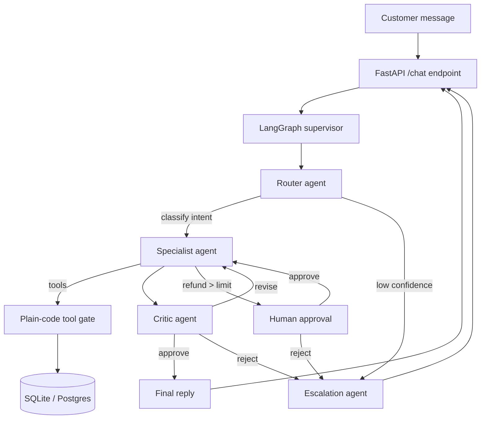
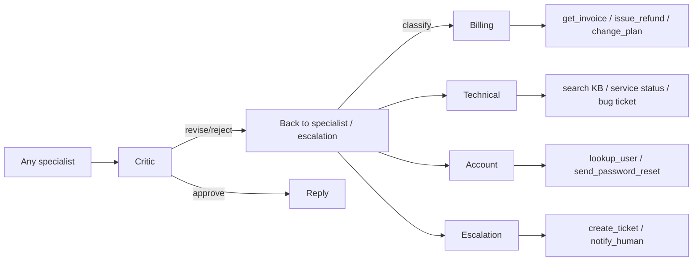
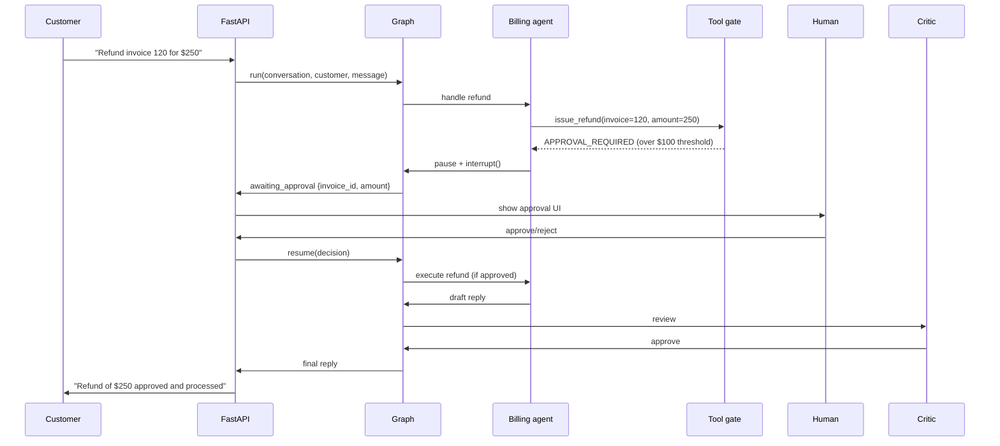

# SupportDesk — architecture walkthrough

This document is the 5-minute technical talk track for an interview, backed by
Mermaid diagrams you can draw on a whiteboard.

## The big picture

**Threads:** every conversation is a LangGraph thread (`thread_id = conversation_id`),
so state and memory persist across turns and across the human-in-the-loop
interrupt/resume cycle.

---

## The six agents

| Agent | Tools | Notes |
|-------|-------|-------|
| Router | none | Structured output: intent, urgency, confidence |
| Billing | `get_invoice`, `issue_refund`, `change_plan` | No other tools |
| Technical | `search_knowledge_base`, `get_service_status`, `create_bug_ticket` | RAG + citations |
| Account | `lookup_user`, `send_password_reset` | Own account only |
| Escalation | `create_ticket`, `notify_human_agent` | Human handoff |
| Critic | none | Policy / PII / hallucination check on every draft |

## Key data flow: the refund-above-limit path

## Conversation memory

LangGraph's `InMemorySaver` checkpoints the full `AgentState` for every thread.
Resume after a human decision uses `Command(resume=...)`, and the graph continues
exactly where it paused (the node after `interrupt` re-runs idempotently).

## Tech stack

| Layer | Choice |
|-------|--------|
| Language | Python 3.12 |
| Agents / graph | LangChain v1 + LangGraph |
| LLM | ChatNVIDIA (NVIDIA Build API), model + fallback configurable via env |
| API | FastAPI |
| Config / validation | Pydantic v2 + pydantic-settings |
| Database | SQLAlchemy (SQLite locally, Postgres in docker-compose) |
| Testing | pytest (unit / integration / e2e / eval markers), ruff, mypy |
| CI | GitHub Actions |

## The 5-minute talk track

1. **30s — What it is:** "SupportDesk is a six-agent customer-support system built with LangChain v1 and LangGraph. It routes messages to specialists, guards every tool call with plain-code policy, and escalates to humans when needed."
2. **60s — The flow:** Walk the customer message through Router → Specialist → Critic → Reply, noting the Critic reviews every draft before it's sent.
3. **60s — Safety:** Show the tool-gate allowlist (billing can't call technical tools), the customer-scoping rule (no cross-customer data), the refund-above-limit human approval, and PII redaction in logs.
4. **60s — Failure modes:** Low router confidence → escalation. Two failed tool validations → escalation. Critic rejection after one revision → escalation. Prompt injection → blocked.
5. **60s — Evals:** "We run a 150-ticket labeled corpus through a deterministic fake LLM and report routing accuracy (74%) and tool-selection accuracy against a committed baseline — CI fails if accuracy drops more than 5 points."
6. **30s — At 100x scale:** "Swap InMemorySaver for Postgres checkpointers, add rate limiting, and move RAG to a real vector store."
